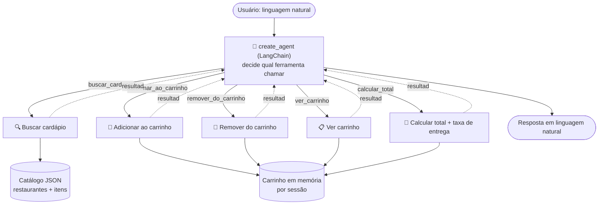

# food-order-agent

## 1. O que é

Um agente conversacional de pedidos de comida: você descreve o que quer em linguagem natural ("quero uma pizza vegetariana até R$ 50"), e o agente usa **ferramentas** (tool calling, via `create_agent` do LangChain) para buscar no cardápio, montar o carrinho e calcular o total. O catálogo, os preços e o carrinho são sempre dados determinísticos — o LLM decide qual ferramenta chamar, mas nunca inventa item ou preço que não exista.

```
você: quero uma pizza vegetariana
agente: Aqui estão as pizzas vegetarianas que temos no momento:

| Código | Nome | Preço | Restaurante |
|---|---|---|---|
| pizza-margherita | Pizza Margherita | R$ 42,90 | Pizzaria Napoli |
| pizza-quatro-queijos | Pizza Quatro Queijos | R$ 45,90 | Pizzaria Napoli |

Qual delas você gostaria de adicionar ao carrinho?

você: adiciona a margherita no carrinho
agente: Sua Pizza Margherita já está no carrinho:
- Pizza Margherita – R$ 42,90 (1 unidade)
Subtotal: R$ 42,90
Para finalizar, preciso saber a distância (em km) até o endereço de entrega.

você: qual o total pra entrega de 5km?
agente: Resumo do pedido
- Pizza Margherita – R$ 42,90
Taxa de entrega (5 km): R$ 11,00
Total: R$ 53,90
```

## 2. Arquitetura

### Visão geral



### Componentes

| Componente | Responsabilidade |
|---|---|
| **create_agent (LangChain)** | Recebe a mensagem do usuário + histórico da sessão, decide qual(is) ferramenta(s) chamar, interpreta o resultado e responde em linguagem natural. Por baixo, monta um grafo (LangGraph) que executa o loop modelo→ferramenta→modelo até não haver mais chamada de ferramenta pendente. Nunca inventa item/preço: só pode citar o que veio de uma ferramenta. |
| **Ferramentas (`tools.py`)** | `buscar_cardapio(query, categoria=None, vegetariano=None, preco_max=None)`, `adicionar_ao_carrinho(item_id, quantidade)`, `remover_do_carrinho(item_id)`, `ver_carrinho()`, `calcular_total(distancia_km)`. Cada uma com schema Pydantic de argumentos. |
| **Catálogo (`catalog.py` + `data/menu.json`)** | Dados estáticos de restaurantes fictícios com itens, categoria, preço e tags (vegetariano, etc.). Fonte única de verdade — a ferramenta de busca filtra sobre isso, nunca sobre texto livre do LLM. |
| **Carrinho (`cart.py`)** | Estado em memória por `session_id`: lista de itens + quantidade, subtotal e total. |
| **LLM Client** | `ChatOpenAI` do LangChain configurado com `base_url`/`api_key` livres via env var — qualquer provedor compatível com a API da OpenAI. |

### Fluxo de uma conversa

1. Usuário manda mensagem → API/CLI inclui `session_id` + histórico.
2. O agente decide: responde direto, ou chama 1+ ferramentas.
3. Ferramenta roda contra catálogo/carrinho reais (nunca contra o texto do LLM) e devolve um resultado estruturado.
4. Agente usa o resultado da ferramenta para formular a resposta final.
5. Estado do carrinho persiste na sessão até o checkout.

## 3. Como rodar

```bash
uv sync --extra dev
cp .env.example .env
# edite .env com seu provedor

# CLI (chat no terminal)
uv run foodagent

# API (http://localhost:8000/docs)
uv run uvicorn foodagent.api:app --reload

# testes (não dependem de nenhuma API key, usam um chat model fake)
uv run pytest -q
```

```env
LLM_BASE_URL=https://generativelanguage.googleapis.com/v1beta/openai/
LLM_API_KEY=...
LLM_MODEL=gemini-2.0-flash

TAXA_ENTREGA_FIXA=5.00
TAXA_ENTREGA_POR_KM=1.20
```

### Docker

```bash
docker compose up --build
# API disponível em http://localhost:8000/docs
```

## 4. CLI e API

### CLI (chat no terminal)

```bash
uv run foodagent
você: quero uma pizza vegetariana até R$ 50
```

### API

- `POST /chat` — `{ "session_id": "...", "message": "..." }` → resposta + carrinho atual
- `GET /health`
- Swagger em `/docs`

```bash
curl -X POST http://localhost:8000/chat \
  -H "Content-Type: application/json" \
  -d '{"session_id": "s1", "message": "quero um burger vegetariano"}'
```

```json
{
  "reply": "Encontrei um Burger Veggie (vegetariano) por R$ 34,00 do restaurante Burger House. Gostaria de adicioná-lo ao seu carrinho?",
  "carrinho": [],
  "subtotal": 0.0
}
```

A sessão (`session_id`) mantém o histórico da conversa e o carrinho entre chamadas — mande outra mensagem com o mesmo `session_id` pra continuar de onde parou.

## 5. Próximos passos

- Persistir carrinho/sessão em banco (Redis/Postgres) em vez de memória.
- Ferramenta de cupom de desconto.
- Multi-restaurante no mesmo carrinho com taxas de entrega separadas.
- Streaming da resposta do agente (hoje é só request/response).
